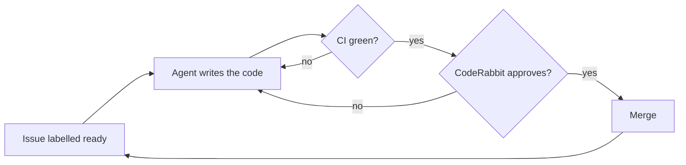

# PEPPEC

*A **P**atient **E**ngineer that **P**lans, **P**rograms, **E**valuates, **C**ommits.*

PEPPEC turns the issues of a GitHub repository into reviewed pull requests while you sleep. Claude Code agents pick up the issues one at a time, oldest first; each pull request must pass CI and a CodeRabbit review before it is merged, by you or automatically. A Telegram bot keeps you informed and lets you answer the agent's questions from your phone.

It runs on GitHub Actions, your Claude subscription and a small always-on machine for the bot (a Raspberry Pi is enough). There are no servers to expose and no webhooks to receive.

## How it works



- **One move at a time.** A workflow wakes up every 15 minutes and on every relevant event, reads the state back from GitHub labels and picks exactly one move. It can restart at any point without losing track.
- **Hard limits.** Review rounds, attempts to fix the checks and working time per issue are capped. Past a limit the queue stops and you get a Telegram message.
- **Questions instead of guesses.** If an issue is unclear, the agent asks. Reply to the Telegram message and the work resumes.
- **Any language.** Everything language-specific lives in a [preset](presets): the toolchain setup, the check commands, the tools the agent may use.

The full picture is in [docs/architecture.md](docs/architecture.md).

## Install

The command line does most of the work. Install it once, outside your projects:

```bash
mkdir -p ~/.local/bin
curl -fsSL https://raw.githubusercontent.com/PeppeColi/peppec/v1/cli/peppec -o ~/.local/bin/peppec
chmod +x ~/.local/bin/peppec
```

Then, inside a clone of your repository:

```bash
peppec init      # labels, settings, variables, secrets, workflow files, branch protection
peppec doctor    # checks the installation
peppec bot       # prepares the folder for the machine that runs the Telegram bot
```

One bot can follow several repositories: `peppec bot -R owner/first -R owner/second`.

If `~/.local/bin` is not in your `PATH`, call it with its full path. `peppec update` replaces the script with the current version.

It asks for what only you can provide: the GitHub App, the tokens, your preferences. [docs/setup.md](docs/setup.md) explains each step and how to do everything by hand.

Your repository ends up with three small workflow files that call this one, a one-line configuration and a set of labels, variables and secrets:

```yaml
# .github/peppec.yml
preset: rust-v1
```

```yaml
# .github/workflows/ci.yml
jobs:
  ci:
    uses: PeppeColi/peppec/.github/workflows/ci.yml@v1
    with:
      engine_ref: v1
```

## Presets

| Preset | For |
| --- | --- |
| [`rust-v1`](presets/rust-v1) | Rust projects built with Cargo |
| [`php-v1`](presets/php-v1) | PHP projects that manage their dependencies with Composer |

A preset is a directory with a setup action, default check commands and a small test project. New presets are welcome: see [CONTRIBUTING.md](CONTRIBUTING.md).

## What is in this repository

| Path | Content |
| --- | --- |
| `.github/workflows/agent.yml`, `ci.yml`, `summary.yml` | The reusable workflows your repository calls |
| `scripts/` | The logic of the queue: what to do next, how to prepare the task, what to do with the result |
| `presets/` | One directory per language setup |
| `bot/` | The Telegram bot, published as `ghcr.io/peppecoli/peppec-bot` |
| `examples/` | The files to copy into your repository |
| `cli/peppec` | The command line that installs and checks PEPPEC on a repository |
| `docs/` | Architecture and setup guide |

## Security in one paragraph

Agents work only on issues you labelled `ready`, and read instructions only from your comments. Each secret reaches only the workflow step that needs it; the step where Claude runs never sees the GitHub or Telegram tokens. The agent cannot change workflows, the configuration or the files that define the checks, and it never commits or pushes: the workflow does, after checking what changed. Details are in [docs/architecture.md](docs/architecture.md#security).

## License

[MIT](LICENSE)
