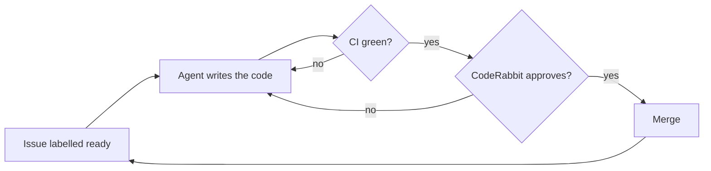

# PEPPEC

*A **P**atient **E**ngineer that **P**lans, **P**rograms, **E**valuates, **C**ommits.*

PEPPEC turns the issues of a GitHub repository into reviewed pull requests while you sleep. Claude Code agents pick up the issues one at a time, oldest first; each pull request must pass CI and a CodeRabbit review before it is merged, by you or automatically. A Telegram bot keeps you informed and lets you answer the agent's questions from your phone.

It runs on GitHub Actions, your Claude subscription and a small always-on machine for the bot (a Raspberry Pi is enough). There are no servers to expose and no webhooks to receive.

## How it works



- **One move at a time.** A workflow wakes up on every relevant event and whenever the Telegram bot pings it (every 15 minutes while there is work), reads the state back from GitHub labels and picks exactly one move. It can restart at any point without losing track.
- **Hard limits.** Review rounds, attempts to fix the checks and working time per issue are capped. From the second review round the largest model takes over; at the last one, findings that are all minor let the review pass. Past a limit the queue stops and you get a Telegram message.
- **Questions instead of guesses.** If an issue is unclear, the agent asks, and says which answer it recommends. Press Accept or reply to the Telegram message, and the work resumes.
- **Features on their own branch, if you want.** Each specification can get an integration branch: the agent builds its work units there, brings the base branch in at the end (an agent resolves the conflicts), runs your end-to-end tests, and opens a pull request that only you merge. See [Feature branches](docs/setup.md#feature-branches).
- **Any language.** Everything language-specific lives in a [preset](presets): the toolchain setup, the check commands, the tools the agent may use.

The full picture is in [docs/architecture.md](docs/architecture.md).

## Install

The command line does most of the work. Install it in one of two ways.

**Option 1: gh extension (recommended).** It always runs the current version, so there is nothing to update:

```bash
gh extension install PeppeColi/gh-peppec
```

Call it as `gh peppec`: type `gh peppec init` wherever these pages write `peppec init`.

**Option 2: script.** Install it once, outside your projects:

```bash
mkdir -p ~/.local/bin
curl -fsSL https://raw.githubusercontent.com/PeppeColi/peppec/v2/cli/peppec -o ~/.local/bin/peppec
chmod +x ~/.local/bin/peppec
```

Call it as `peppec`, and bring it up to date with `peppec update` (more below).

> [!NOTE]
> **Using Matt Pocock's skills?** Set them up before `peppec init`: type `/setup-matt-pocock-skills` in a Claude Code session (or your agent harness of choice) opened in the clone, and accept every suggested answer (GitHub as issue tracker, the default label names, single-context domain docs). `peppec init` then applies what PEPPEC needs: it maps their `ready-for-agent` label to `ready` and adds the PEPPEC section to `CLAUDE.md`. Run the setup inside the clone, where the remote tells it to propose GitHub: `init` does not change the issue tracker if you pick another one.

Then, inside a clone of your repository, run these commands in a terminal of your own, not from inside Claude Code or another agent harness (for example with `!`): `init` asks questions and opens pages in the browser, and the harness neither shows the questions nor lets you answer them.

```bash
peppec init      # labels, settings, variables, secrets, workflow files, CLAUDE.md section, branch protection
peppec doctor    # checks the installation
peppec bot       # prepares the folder for the machine that runs the Telegram bot
peppec skills    # checks the planning skills on this computer (also run by a SessionStart hook)
```

One bot can follow several repositories: `peppec bot -R owner/first -R owner/second`.

If `~/.local/bin` is not in your `PATH`, call it with its full path. `peppec update` replaces the script with the current version and names the release it comes from; it compares only the script, so a release that changes the workflows alone finds nothing to update: the engine's workflows reach your repository by themselves at `v2`, and `peppec init` refreshes the files it wrote there. It never moves to a new major version by itself, which may need changes on your side: it tells you when one is out, and `PEPPEC_REF=v2 peppec update` moves a copy that still follows `v1`.

It asks for what only you can provide: the tokens and your preferences. It creates the GitHub App with you, in the browser: you only confirm. [docs/setup.md](docs/setup.md) explains each step and how to do everything by hand.

Your repository ends up with three small workflow files that call this one, a one-line configuration and a set of labels, variables and secrets:

```yaml
# .github/peppec.yml
preset: rust-v1
```

```yaml
# .github/workflows/ci.yml
jobs:
  ci:
    uses: PeppeColi/peppec/.github/workflows/ci.yml@v2
    with:
      engine_ref: v2
```

## Presets

| Preset | For |
| --- | --- |
| [`rust-v1`](presets/rust-v1) | Rust projects built with Cargo |
| [`php-v1`](presets/php-v1) | PHP projects that manage their dependencies with Composer |
| [`none`](presets/none) | A project whose language is not chosen yet: PEPPEC installs, the agent builds nothing |

A preset is a directory with a setup action, default check commands and a small test project. New presets are welcome: see [CONTRIBUTING.md](CONTRIBUTING.md).

## What is in this repository

| Path | Content |
| --- | --- |
| `.github/workflows/agent.yml`, `ci.yml`, `summary.yml` | The reusable workflows your repository calls |
| `scripts/` | The logic of the queue: what to do next, how to prepare the task, what to do with the result |
| `presets/` | One directory per language setup |
| `bot/` | The Telegram bot, published as `ghcr.io/peppecoli/peppec-bot` |
| `examples/` | The files to copy into your repository |
| `cli/peppec` | The command line that installs and checks PEPPEC on a repository |
| `docs/` | Architecture, setup guide, [how to plan work for the agents](docs/planning.md), the [notifications](docs/notifications.md) and the [glossary](docs/glossary.md) |

## Security in one paragraph

Agents work only on issues you wrote and labelled `ready`, and read instructions only from your comments. Claude runs in a job of its own, with no token that can write to GitHub; a separate job checks its changes and pushes them. The agent cannot change workflows, the configuration or the files that define the checks, and it never commits or pushes: the workflow does, after checking what changed. Details are in [docs/architecture.md](docs/architecture.md#security).

## Notifications

The Telegram bot tells you what happens, each message prefixed with its repository (`[owner/name]`). Only the messages that need you make the phone ring (🔔); the others arrive silently (🔕) and stay in the chat as a trace. Every message, with what to do about it, is in [docs/notifications.md](docs/notifications.md).

## License

[MIT](LICENSE)
