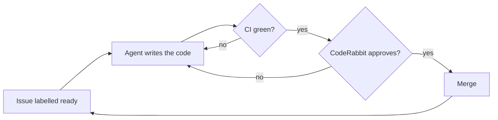

# PEPPEC

*A **P**atient **E**ngineer that **P**lans, **P**rograms, **E**valuates, **C**ommits.*

PEPPEC turns the issues of a GitHub repository into reviewed pull requests while you sleep. Claude Code agents pick up the issues one at a time, oldest first; each pull request must pass CI and a CodeRabbit review before it is merged, by you or automatically. A Telegram bot keeps you informed and lets you answer the agent's questions from your phone.

It runs on GitHub Actions, your Claude subscription and a small always-on machine for the bot (a Raspberry Pi is enough). There are no servers to expose and no webhooks to receive.

## How it works



- **One move at a time.** A workflow wakes up every 15 minutes and on every relevant event, reads the state back from GitHub labels and picks exactly one move. It can restart at any point without losing track.
- **Hard limits.** Review rounds, attempts to fix the checks and working time per issue are capped. Past a limit the queue stops and you get a Telegram message.
- **Questions instead of guesses.** If an issue is unclear, the agent asks, and says which answer it recommends. Press Accept or reply to the Telegram message, and the work resumes.
- **Features on their own branch, if you want.** Each specification can get an integration branch: the agent builds its work units there, brings the base branch in at the end (an agent resolves the conflicts), runs your end-to-end tests, and opens a pull request that only you merge. See [Feature branches](docs/setup.md#feature-branches).
- **Any language.** Everything language-specific lives in a [preset](presets): the toolchain setup, the check commands, the tools the agent may use.

The full picture is in [docs/architecture.md](docs/architecture.md).

## Notifications

Every message starts with the repository it comes from, as in `[owner/name]`. Only the messages that need you make the phone ring (🔔); the others arrive silently (🔕), without sound or vibration, and stay in the chat as a trace.

| Message | What to do | Sound |
| --- | --- | --- |
| Queue stopped on #N (no CI result, checks still failing, no CodeRabbit review, review not passed, time budget used up, branch not valid) | Fix it, then press Unblock or Hint | 🔔 |
| The agent is blocked on #N (agent error, no changes, protected files changed, conflict markers left, changes not applicable) | Press Unblock or Hint | 🔔 |
| Claude token rejected | Run `claude setup-token` and update the secret | 🔔 |
| Question on #N | Reply, or press Accept for the recommended answer | 🔔 |
| PR #N is ready to merge (manual mode) | Merge it | 🔔 |
| The feature of #N is ready to be tried | Try it, merge it, or press Report a problem | 🔔 |
| The base branch does not exist | Create it again | 🔔 |
| #N has `ready-for-agent` but not `ready` | Run `peppec doctor`, then label it `ready` | 🔔 |
| #N has `ready` but is not a work unit | Move `ready` to its sub-issues | 🔔 |
| #N has `ready` but was not written by you (the label is removed) | Copy what you want built into an issue of your own | 🔔 |
| The end-to-end tests still fail after the hotfixes, or gave no result | Fix them by hand, or press Report a problem | 🔔 |
| The base branch could not be brought into a feature | Merge it by hand | 🔔 |
| The decide step failed | Open the run | 🔔 |
| Daily summary with a token about to expire | Renew the token | 🔔 |
| Merged PR #N (automatic mode) | Nothing | 🔕 |
| Claude quota exhausted: will retry automatically | Nothing | 🔕 |
| The agent changed nothing and answered CodeRabbit | Nothing | 🔕 |
| The base branch is back: the queue goes on | Nothing | 🔕 |
| The end-to-end tests failed: #M will fix them | Nothing | 🔕 |
| The base branch and a feature conflict: #M will resolve it | Nothing | 🔕 |
| The base branch changed and is merged into a feature | Try its latest version, if you are trying it | 🔕 |
| Dashboard: … (the trace of what you did on the dashboard) | Nothing | 🔕 |
| Daily summary | Read it; not sent on a day with nothing merged, blocked, asked or in queue | 🔕 |

The bot's answers to your commands (`/status`, `/pause`, …) are normal messages.

## Install

The command line does most of the work. The simplest way is the gh extension, which always runs the current version:

```bash
gh extension install PeppeColi/gh-peppec
```

With it, type `gh peppec` wherever this page says `peppec`. Or install the script once, outside your projects:

```bash
mkdir -p ~/.local/bin
curl -fsSL https://raw.githubusercontent.com/PeppeColi/peppec/v1/cli/peppec -o ~/.local/bin/peppec
chmod +x ~/.local/bin/peppec
```

Then, inside a clone of your repository:

```bash
peppec init      # labels, settings, variables, secrets, workflow files, CLAUDE.md section, branch protection
peppec doctor    # checks the installation
peppec bot       # prepares the folder for the machine that runs the Telegram bot
peppec skills    # checks the planning skills on this computer (also run by a SessionStart hook)
```

One bot can follow several repositories: `peppec bot -R owner/first -R owner/second`.

If `~/.local/bin` is not in your `PATH`, call it with its full path. `peppec update` replaces the script with the current version and names the release it comes from; it compares only the script, so a release that changes the workflows alone finds nothing to update.

It asks for what only you can provide: the tokens and your preferences. It creates the GitHub App with you, in the browser: you only confirm. [docs/setup.md](docs/setup.md) explains each step and how to do everything by hand.

Your repository ends up with three small workflow files that call this one, a one-line configuration and a set of labels, variables and secrets:

```yaml
# .github/peppec.yml
preset: rust-v1
```

```yaml
# .github/workflows/ci.yml
jobs:
  ci:
    uses: PeppeColi/peppec/.github/workflows/ci.yml@v1
    with:
      engine_ref: v1
```

## Presets

| Preset | For |
| --- | --- |
| [`rust-v1`](presets/rust-v1) | Rust projects built with Cargo |
| [`php-v1`](presets/php-v1) | PHP projects that manage their dependencies with Composer |

A preset is a directory with a setup action, default check commands and a small test project. New presets are welcome: see [CONTRIBUTING.md](CONTRIBUTING.md).

## What is in this repository

| Path | Content |
| --- | --- |
| `.github/workflows/agent.yml`, `ci.yml`, `summary.yml` | The reusable workflows your repository calls |
| `scripts/` | The logic of the queue: what to do next, how to prepare the task, what to do with the result |
| `presets/` | One directory per language setup |
| `bot/` | The Telegram bot, published as `ghcr.io/peppecoli/peppec-bot` |
| `examples/` | The files to copy into your repository |
| `cli/peppec` | The command line that installs and checks PEPPEC on a repository |
| `docs/` | Architecture, setup guide and [how to plan work for the agents](docs/planning.md) |

## Security in one paragraph

Agents work only on issues you wrote and labelled `ready`, and read instructions only from your comments. Claude runs in a job of its own, with no token that can write to GitHub; a separate job checks its changes and pushes them. The agent cannot change workflows, the configuration or the files that define the checks, and it never commits or pushes: the workflow does, after checking what changed. Details are in [docs/architecture.md](docs/architecture.md#security).

## License

[MIT](LICENSE)
