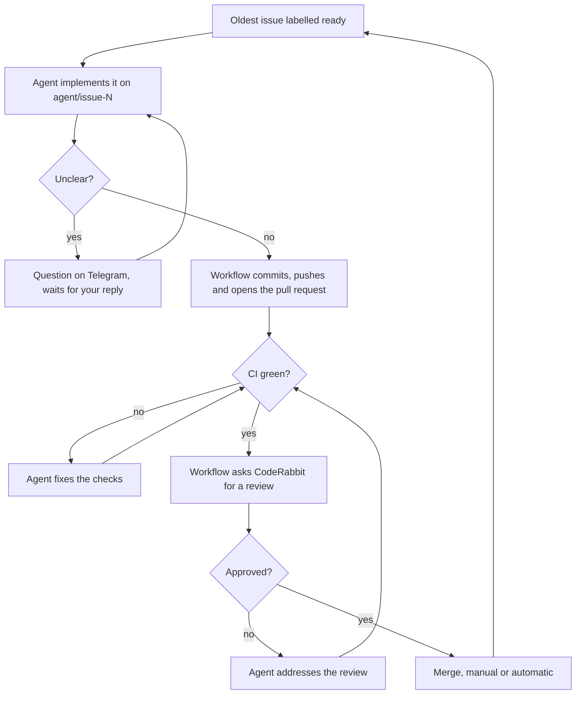

# Architecture

## Goal

Claude Code agents resolve the issues of a GitHub repository, one at a time, oldest first. Each issue becomes a pull request, goes through automated checks and a CodeRabbit review, then is merged manually or automatically.

Two repositories are involved:

- the **engine**, this repository, with the workflows, the scripts, the presets and the bot;
- the **host**, your repository, where the issues live and the agents work. It calls the engine's workflows and holds the configuration, the secrets and the variables.

## Components

| Component | Runs on | Role |
| --- | --- | --- |
| Reusable workflows | GitHub Actions, in the host | Orchestrate the queue, triggers, limits and notifications |
| Claude Code (`claude-code-action`) | GitHub Actions | Writes the code and addresses reviews |
| CodeRabbit | GitHub App | Reviews the pull requests |
| A GitHub App of yours | Installed on the host | Applies labels, merges, keeps the hidden counters; one-hour tokens generated on demand |
| Telegram bot | Any always-on machine, long polling | Forwards notifications and questions, receives commands and answers; acts on GitHub as the app |
| Your GitHub account | — | Owns the host and authors the agent's commits and pull requests |

The bot uses long polling, so it needs no public address and no open ports. Notifications are sent from GitHub Actions, so they arrive even if the bot is down.

## Issue flow



A single workflow wakes up every 15 minutes and on every relevant event: CI finished, review submitted, pull request closed, bot command. Each time it reads the state back from GitHub and picks exactly one move, so it can restart at any point. Only one run executes at a time.

## Presets and configuration

Everything that depends on the language lives in a preset, a directory of the engine:

| File | Content |
| --- | --- |
| `action.yml` | A composite action that installs the toolchain and the dependencies |
| `preset.yml` | Defaults: project description, check commands, notes for the agent, allowed and disallowed tools, protected paths |
| `fixture/` | A minimal project used to test the preset |

The host chooses a preset in `.github/peppec.yml` and can override any default:

```yaml
preset: rust-v1
check: |
  cargo fmt --all -- --check
  cargo test --all-features
```

Two more keys cover what a preset cannot know: `options` passes values to the preset (a language version, extensions), and `extra_setup` names a setup action of the host, run after the preset's, for services and system packages.

CI and the agent use the same definition: CI runs the setup and the check commands, and the agent's prompt tells it to run the same commands until they pass.

The configuration is always read from `main`. Pull requests from `agent/*` branches are checked with the configuration of the base branch, so the agent cannot weaken its own checks.

## Model selection

The model depends on the complexity label of the issue.

- **complexity: simple** → Sonnet; if the review still fails, Opus takes over from the round set in `OPUS_FROM_ROUND`.
- **complexity: complex** → Opus from the start.

## Checks, review and limits

A pull request reaches CodeRabbit only after CI passes. The review passes when CodeRabbit approves the latest commit. When a new commit contains nothing CodeRabbit reviews, such as a lockfile or a deleted file, it gives no new verdict and only declares the review finished: the previous approval then stands.

| Limit | Variable | Past the limit |
| --- | --- | --- |
| Attempts to make the checks pass, per review round | `MAX_CI_ATTEMPTS` | Queue stops, Telegram notification |
| Review rounds, tracked with the `review N` labels | `MAX_REVIEW_ROUNDS` | `needs human` label, queue stops, Telegram notification |
| Agent working time per issue, summed over all runs | `MAX_ISSUE_MINUTES` | Queue stops, Telegram notification |
| Wait for a CI result, from the latest commit | `STALL_MINUTES` | Queue stops |
| Wait for a CodeRabbit review, from the latest commit | twice `STALL_MINUTES` | Queue stops |

Waits for quota, CI and CodeRabbit do not count as working time. Counters move only after a successful push: if a run is interrupted, the same move is repeated without spending a round.

## Schedule and quota

Agents start new issues only inside the work window (`WORK_START_HOUR`–`WORK_END_HOUR`). An issue already in progress is always finished. In manual mode, merging a pull request starts the next issue right away, at any hour.

When the Claude quota runs out, the issue gets the `awaiting quota` label, you get a notification, and the workflow retries after `QUOTA_RETRY_MINUTES`.

## Merge modes

| Mode | Who merges | Effect on the queue |
| --- | --- | --- |
| Manual (default) | You, with the Merge button | The queue waits for your merge |
| Automatic | The workflow, as the app, as soon as the review passes | The queue runs on its own through the work window |

## Telegram bot

The bot answers only your chat and acts on GitHub as the app.

| Command | Effect |
| --- | --- |
| `/status` | Mode, pause, current issue with labels, issues in queue |
| `/pause` | Stops the whole queue |
| `/unblock [n]` | Clears pause and blocks, resets the issue's time budget and counters, restarts |
| `/hint <n> <text>` | Comments the hint on the issue, unblocks it and restarts |
| `/mode manual` or `/mode automatic` | Switches the merge mode |
| `/version` | The bot's version |
| Reply to a "Question on #N" message | Posts the reply on the issue and restarts the work |

## Labels

| Label | Where | Set by | Meaning |
| --- | --- | --- | --- |
| `ready` | Issue | You | The issue can be picked up |
| `complexity: simple` / `complex` | Issue | You | Chooses the model |
| `in progress` | Issue | Workflow | Issue being worked on |
| `question open` | Issue | Workflow | Waiting for your answer |
| `awaiting quota` | Issue | Workflow | Resumes when the quota is back |
| `review 1`, `2`, `3` | Pull request | Workflow | Current review round |
| `ci 1`–`5` | Pull request | Workflow | Attempts to make the checks pass |
| `ready to merge` | Pull request | Workflow | Review passed, waiting for you |
| `needs human` | Issue and pull request | Workflow | Limits exceeded, queue stopped |
| `paused` / `auto mode` | Control panel issue | Bot | Global pause and merge mode |

Two hidden counters are kept as comments (`<!-- peppec:KEY=VALUE -->`): the minutes worked on an issue and the commit a review was requested for.

## Security

On a public repository anyone can open issues and comment. These rules stop a stranger, and the agent itself, from steering the system.

- **Who gives instructions.** Agents work only on issues labelled `ready`, and only you and the app can apply labels. The task contains only the comments written by your account and by the app.
- **Who can command the bot.** Only your Telegram chat.
- **Secrets per step.** Each secret reaches only the step that needs it. The step where Claude runs sees only the Claude token; the app token is created after Claude has finished.
- **The agent never commits.** The workflow commits and pushes, after checking what changed. Changes to protected paths (`.github`, plus the ones of the preset and of the configuration) are refused and the issue is labelled `needs human`.
- **Engine and configuration out of reach.** The scripts and the presets come from the engine repository at a fixed ref; the configuration comes from `main`. The agent's token has no permission on workflows. After Claude has run, the workflow takes a fresh copy of the scripts before using the GitHub tokens.
- **Forks.** Pull requests from forks never receive secrets, and the orchestrator ignores them.

One limit to know: the tools the agent may run (`cargo`, `npm`, …) execute code from the repository, in the same job that later uses the GitHub tokens. The measures above reduce the risk; they are not a sandbox.
