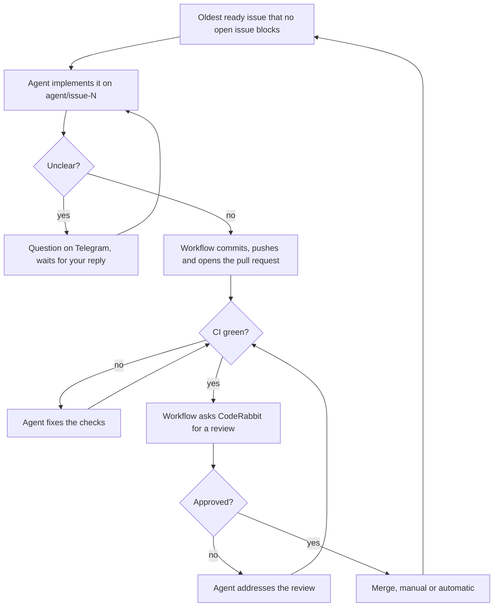

# Architecture

## Goal

Claude Code agents resolve the issues of a GitHub repository, one at a time, oldest first. Each issue becomes a pull request, goes through automated checks and a CodeRabbit review, then is merged manually or automatically.

Two repositories are involved:

- the **engine**, this repository, with the workflows, the scripts, the presets and the bot;
- the **host**, your repository, where the issues live and the agents work. It calls the engine's workflows and holds the configuration, the secrets and the variables.

## Components

| Component | Runs on | Role |
| --- | --- | --- |
| Reusable workflows | GitHub Actions, in the host | Orchestrate the queue, triggers, limits and notifications |
| Claude Code (`claude-code-action`) | GitHub Actions | Writes the code and addresses reviews |
| CodeRabbit | GitHub App | Reviews the pull requests |
| A GitHub App of yours | Installed on the host | Applies labels, merges, keeps the hidden counters; one-hour tokens generated on demand |
| Telegram bot | Any always-on machine, long polling | Forwards notifications and questions, receives commands and answers; acts on GitHub as the app |
| Your GitHub account | — | Owns the host and authors the agent's commits and pull requests |

The bot uses long polling, so it needs no public address and no open ports. Notifications are sent from GitHub Actions, so they arrive even if the bot is down.

## Issue flow



The queue is the open issues labelled `ready`, oldest first. An issue that another open issue blocks (GitHub's "blocked by" relationship, in the sidebar of the issue or with `gh issue edit <N> --add-blocked-by <M>`) is skipped until the blocking issue is closed, so a group of issues can be queued at once and still be built in order. The daily summary says how many issues are waiting this way: a blocking issue that is not labelled `ready` holds them indefinitely.

An issue can be a sub-issue of a larger one that holds the specification of a whole feature. The agent then receives the body of the parent too, in `.agent/spec.md`, as background: it builds only what its own issue asks. The "Out of scope" section of the issue, when there is one, is copied into the pull request, so that the reviewer does not ask for work that belongs to another issue. When the last sub-issue of a parent is closed you get a Telegram message: the whole feature is merged and can be tried.

A single workflow wakes up every 15 minutes and on every relevant event: CI finished, review submitted, pull request closed, bot command. Each time it reads the state back from GitHub and picks exactly one move, so it can restart at any point. Only one run executes at a time.

## Presets and configuration

Everything that depends on the language lives in a preset, a directory of the engine:

| File | Content |
| --- | --- |
| `action.yml` | A composite action that installs the toolchain and the dependencies |
| `preset.yml` | Defaults: project description, check commands, notes for the agent, allowed and disallowed tools, protected paths |
| `fixture/` | A minimal project used to test the preset |

The host chooses a preset in `.github/peppec.yml` and can override any default:

```yaml
preset: rust-v1
check: |
  cargo fmt --all -- --check
  cargo test --all-features
```

Two more keys cover what a preset cannot know: `options` passes values to the preset (a language version, extensions), and `extra_setup` names a setup action of the host, run after the preset's, for services and system packages.

CI and the agent use the same definition: CI runs the setup and the check commands, and the agent's prompt tells it to run the same commands until they pass.

The configuration is always read from the base branch: `main`, or the branch named by the `BASE_BRANCH` variable. Pull requests from `agent/*` branches are checked with the configuration of the base branch, so the agent cannot weaken its own checks.

## Model selection

The model depends on the size label of the issue. The models are set in `.github/peppec.yml`:

```yaml
models:
  s: haiku
  m: sonnet
  l: opus
```

These are the defaults. A value is a model alias or a full model ID; you can set one size and leave the others.

- **size: S** → the `s` model. Keep it for mechanical changes: a lighter model that needs more review rounds saves nothing.
- **size: M**, or no size label → the `m` model.
- **size: L** → the `l` model from the start.

If the review still fails, the `l` model takes over from the round set in `LARGE_FROM_ROUND`, whatever the size.

## Checks, review and limits

A pull request reaches CodeRabbit only after CI passes. The review passes when CodeRabbit approves the latest commit. When a new commit contains nothing CodeRabbit reviews, such as a lockfile or a deleted file, it gives no new verdict and only replies that the review is finished or that every file was excluded by its path filters: the previous approval then stands. CodeRabbit answers every review request with a comment: a request that gets no answer at all (CodeRabbit not installed yet, or unavailable) is repeated after 20 minutes, up to three requests per commit.

The agent does not have to agree with every finding. When it leaves one unchanged on purpose, for example because another issue of the feature covers it, it writes its reasons and the workflow posts them as a reply in the thread of that finding. CodeRabbit weighs the reply and approves when convinced. If it has not approved after 20 minutes, the next round starts and the agent reads CodeRabbit's answers. A round in which the agent neither changes the code nor replies stops the queue with `needs human`.

| Limit | Variable | Past the limit |
| --- | --- | --- |
| Attempts to make the checks pass, per review round | `MAX_CI_ATTEMPTS` | Queue stops, Telegram notification |
| Review rounds, tracked with the `review N` labels | `MAX_REVIEW_ROUNDS` | `needs human` label, queue stops, Telegram notification |
| Agent working time per issue, summed over all runs | `MAX_ISSUE_MINUTES` | Queue stops, Telegram notification |
| Wait for a CI result, from the latest commit | `STALL_MINUTES` | Queue stops |
| Wait for a CodeRabbit review, from the latest commit | twice `STALL_MINUTES` | Queue stops |

Waits for quota, CI and CodeRabbit do not count as working time. Counters move only after a successful push or a reply to the review: if a run is interrupted, the same move is repeated without spending a round.

## Schedule and quota

Agents start new issues only inside the work window (`WORK_START_HOUR`–`WORK_END_HOUR`). An issue already in progress is always finished. In manual mode, merging a pull request starts the next issue right away, at any hour.

The schedule is `nightly` by default. With `/schedule always` (the `always on` label on the control panel) new issues start at any hour and the work window is ignored. During the day the agents draw on the same Claude quota you use yourself: that is why nightly is the default. Pausing works in both schedules.

When the Claude quota runs out, the issue gets the `awaiting quota` label, you get a notification, and the workflow retries after `QUOTA_RETRY_MINUTES`.

## Merge modes

| Mode | Who merges | Effect on the queue |
| --- | --- | --- |
| Manual (default) | You, with the Merge button | The queue waits for your merge |
| Automatic | The workflow, as the app, as soon as the review passes | The queue runs on its own through the work window |

Pull requests are merged into the base branch: `main`, or the branch named by the `BASE_BRANCH` variable. GitHub closes an issue by itself only when its pull request reaches the default branch, so with another base branch the workflow closes it: right after an automatic merge, and at its next run after a merge done by hand. An issue you reopen after a merge is worked on again.

## Telegram bot

The bot answers only your chat and acts on GitHub as the app.

There is little to type. `/status` answers with one message per repository, and under each one the buttons that change it: pause or resume the queue, switch the merge mode and the schedule, unblock the issue in progress or give it a hint. The notifications about a blocked issue carry the Unblock and Hint buttons too. A Hint button asks for the text: write it as the reply the bot opens for you. Typing `/` shows the list of the commands.

The commands still work when typed in full:

| Command | Effect |
| --- | --- |
| `/status [repo]` | Mode, schedule, pause, current issue with labels, issues in queue, and the buttons |
| `/pause [repo]` | Stops the whole queue |
| `/unblock [repo] [n]` | Clears pause and blocks, resets the issue's time budget and counters, restarts |
| `/hint [repo] <n> <text>` | Comments the hint on the issue, unblocks it and restarts; without the text, the bot asks for it |
| `/mode [repo] manual` or `/mode [repo] automatic` | Switches the merge mode |
| `/schedule [repo] nightly` or `/schedule [repo] always` | Switches between the work window and working at any hour |
| `/version` | The bot's version |
| Reply to a "Question on #N" message | Posts the reply on the issue and restarts the work |

One bot can follow several repositories, as long as they share the app, the Telegram bot and the chat. Every notification starts with the repository it comes from, as in `[owner/name] Question on #12:`, and a reply goes to that repository.

With one repository, `repo` is never needed. With several:

- `repo` is the name of the repository, or `owner/name` if two of them have the same name;
- `/status` and `/pause` without a repository apply to all of them;
- the other commands need the repository, unless you send them as a reply to a notification: `/unblock` in reply to a "Queue stopped" message acts on the repository of that message. A command that misses the repository or the value is answered with the buttons.

The Resume button only lifts the pause; `/unblock` and the Unblock button also clear the blocks of the issue and reset its time budget. The buttons on the notifications need a bot of version 1.9 or later.

## Dashboard

The bot can also serve a web page, meant for a phone: the state of every repository at a glance, and the same actions as the bot. It is off unless `DASHBOARD_PASSWORD` is set in the bot's `.env`.

- The home page only shows: what is waiting for you (blocked issues, open questions, pull requests ready to merge in manual mode) and one line per repository. Nothing on it acts.
- Touching a line opens its page, where the buttons are: Unblock and Give a hint on a blocked issue, the answer to a question, the merge mode, the schedule and the pause of a repository.
- Every action taken from the dashboard is also reported in the Telegram chat.

- Optionally, the home page also shows the usage of your Claude subscription: the current session, the weekly limit and any limit per model, each with when it resets. It is read from Anthropic when the page opens and when you press "Refresh usage", never on a timer. It needs Claude Code logged in inside the bot's container (see [setup](setup.md)); without that login the section is hidden. The usage comes from the endpoint behind Claude Code's `/usage`, which Anthropic does not document: if it changes, the section shows an error and the rest of the page keeps working. The token from `claude setup-token` cannot read it, so this is a separate login. When its access token has expired, the bot runs `claude -p ok --model haiku` once to renew it, which costs a tiny Haiku request. The limits are those of your whole account, your own sessions included.

The page asks for the password once and keeps it in the browser. The state is read from GitHub at most every 20 seconds and the page asks for it every 30; the Refresh button reads it again at once. Nothing is stored on the bot's machine.

The dashboard speaks plain HTTP and can act on your repositories: keep it inside your own network, and reach it from outside through a VPN such as Tailscale or WireGuard. Never forward its port from the internet. Without `DASHBOARD_PORT` in `.env`, it answers only on the bot's machine itself.

## Labels

| Label | Where | Set by | Meaning |
| --- | --- | --- | --- |
| `ready` | Issue | You | The issue can be picked up |
| `size: S` / `M` / `L` | Issue | You | Chooses the model |
| `in progress` | Issue | Workflow | Issue being worked on |
| `question open` | Issue | Workflow | Waiting for your answer |
| `awaiting quota` | Issue | Workflow | Resumes when the quota is back |
| `review 1`, `2`, `3` | Pull request | Workflow | Current review round |
| `ci 1`–`5` | Pull request | Workflow | Attempts to make the checks pass |
| `ready to merge` | Pull request | Workflow | Review passed, waiting for you |
| `needs human` | Issue and pull request | Workflow | Limits exceeded, queue stopped |
| `paused` / `auto mode` / `always on` | Control panel issue | Bot | Global pause, merge mode and schedule |

Two hidden counters are kept as comments (`<!-- peppec:KEY=VALUE -->`): the minutes worked on an issue and the commit a review was requested for.

## Security

On a public repository anyone can open issues and comment. These rules stop a stranger, and the agent itself, from steering the system.

- **Who gives instructions.** Agents work only on issues labelled `ready`, and only you and the app can apply labels. The task contains only the comments written by your account and by the app. When the issue is a sub-issue, the body of its parent is added as background, only if your account wrote the parent.
- **Who can command the bot.** Only your Telegram chat.
- **Secrets per step.** Each secret reaches only the step that needs it. The step where Claude runs sees only the Claude token; the app token is created after Claude has finished.
- **The agent never commits.** The workflow commits and pushes, after checking what changed. Dependencies, build output and caches listed by the preset are left out even when the project's `.gitignore` misses them. Changes to protected paths (`.github`, plus the ones of the preset and of the configuration) are refused and the issue is labelled `needs human`.
- **Engine and configuration out of reach.** The scripts and the presets come from the engine repository at a fixed ref; the configuration comes from the base branch. The agent's token has no permission on workflows. After Claude has run, the workflow takes a fresh copy of the scripts before using the GitHub tokens.
- **Forks.** Pull requests from forks never receive secrets, and the orchestrator ignores them.

One limit to know: the tools the agent may run (`cargo`, `npm`, …) execute code from the repository, in the same job that later uses the GitHub tokens. The measures above reduce the risk; they are not a sandbox.
